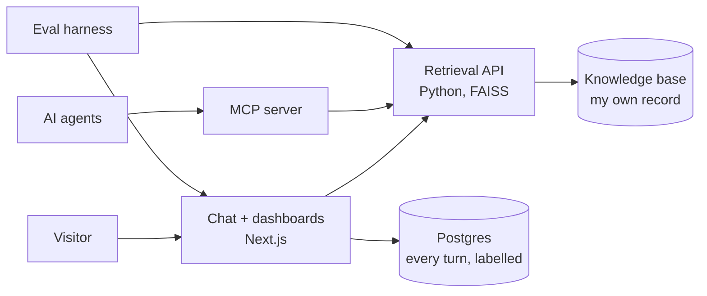

# Hi, I'm Jordanne! 🐱

**Product & AI Builder · 15+ years shipping at scale · Toronto**

[**Ask jordbot about my work →**](https://www.jordannedyck.com) · [LinkedIn](https://www.linkedin.com/in/jordannedyck) · [Email](mailto:jordanne.dyck@gmail.com)

I build AI products customers actually use, and I measure whether they work. At DECIEM (The Ordinary) I shipped agentic AI to production before most companies had a strategy for it. Now I build it end to end myself, evals and monitoring included ([how I evaluate it](https://github.com/jordanne-dyck/jordannedyck-ai/blob/master/EVALS.md)).

My domain is product growth as one system: acquisition, personalization, retention and loyalty. I've done it inside a 16-million-member loyalty ecosystem at Loblaw Digital, and at DECIEM, taking digital from near-zero to $150M+ in annual DTC revenue.

I own the solution in whatever role it needs: strategy, data, design or operations. I work with engineering as a counterpart through the build, not a stakeholder at handoff.

**Looking for:** Senior or Staff Product Manager roles at a high-growth company challenging how its industry works. Canadian ideally.

**Now:** Digital Strategist at Warai Neko, my freelance agency. Independent since November 2025.

---

### 🚀 What I'm Building Now

#### [jordannedyck.com](https://www.jordannedyck.com) · *My portfolio, run as an AI product*

Ask **jordbot**, the AI assistant on the site, anything about my work. It answers from a knowledge base of my own record, cites a source for every claim, and says when the record does not cover something.

I run the site the way I'd run an AI product at work:
- **Evaluated before it ships.** 80 cases, 7 must-pass checks and my own blind scoring. Every comparison carries a 95% range, so a gap inside the noise is reported as noise. [How it's evaluated →](https://github.com/jordanne-dyck/jordannedyck-ai/blob/master/EVALS.md)
- **Monitored after.** Every answer is labelled for grounding, moderation and prompt injection. Volume, latency and spend are public on the [dashboard](https://www.jordannedyck.com/dashboard).
- **The evals made the calls.** They chose the answering model in two blind rounds, kept newer embedding models out after they ranked worse, caught follow-up answers that cited nothing, and found a false claim in my own knowledge base.

<b>How it's built</b>: separate parts that each do one job, so any of them can be swapped, tested or reused

| Part | What it does | Repo |
| --- | --- | --- |
| **Chat front end** | Streamed answers with the cited sources listed under each one. Suggested questions to start, follow-ups answered in context, thumbs up or down on every answer. Input limits and a per-IP rate limit. | [jordannedyck-ai-web](https://github.com/jordanne-dyck/jordannedyck-ai-web) |
| **Monitoring** | Every turn logged to Postgres with emails and phone numbers redacted, then labelled. Health checks every 5 minutes, and one every 6 hours that the chat still gives a grounded answer. | [jordannedyck-ai-web](https://github.com/jordanne-dyck/jordannedyck-ai-web) |
| **Admin view** | Every conversation, anomaly alerts, the questions my record does not cover yet, and real questions exported as new eval cases. | [jordannedyck-ai-web](https://github.com/jordanne-dyck/jordannedyck-ai-web) |
| **Retrieval API** | Hybrid search: embeddings plus BM25 keyword match, merged by reciprocal rank fusion with the embedding top 3 kept, capped per source, and stamped with an index fingerprint so a change in answer quality traces to a specific reindex. | [jordannedyck-ai](https://github.com/jordanne-dyck/jordannedyck-ai) |
| **MCP server** | The same search, exposed as a tool any AI agent can call. | [jordannedyck-ai](https://github.com/jordanne-dyck/jordannedyck-ai) |
| **Eval harness** | Cases, checks, blind scoring and confidence ranges. Uses the same prompt and index as production, and runs on the dev cluster before every release. | [jordannedyck-ai](https://github.com/jordanne-dyck/jordannedyck-ai) |

Runs on OpenShift: containers built in-cluster with Shipwright, deployed from git with Argo CD. CI runs lint, a selftest and a Trivy security scan.

#### [FundLocal](https://fundlocal-ljmo.vercel.app/) · *AI-native community investing, capstone prototype*

Capstone for the Product Faculty AI Product Management Certification. A community investment feature which makes community-scale investing viable, Designed for Wealthsimple and AI PM Capstone project. 

Live prototype: an [investor experience](https://fundlocal-ljmo.vercel.app/) (values intake, AI matching, portfolio) and a [compliance experience](https://fundlocal-ljmo.vercel.app/?view=compliance) (proposal builder, AI evaluation, coaching). AI suggests, a human decides at every critical step.

---

### 📈 Highlighted Ships

Six of the 100+ features I shipped at DECIEM (The Ordinary), as Head of Digital and then Director, Digital Product Management, 2019–2025.

- **AI Personal Shopper · concept to production in 6 months.** Built the first working version myself in Agentforce: product discovery, education, routine building and order management in one conversation. Piloted it, found the failure modes, then scaled. Salesforce featured it at **NRF 2025**.
- **Service automation · 86% faster resolution.** 5,000+ tickets a month, resolution stretching to weeks, 70% of them repetitive. Started with a narrow MVP and measured quality and sentiment before scaling. I defined the escalation logic and guardrails that decide what the AI handles and what goes to a person.
- **Regimen Builder · 35% higher conversion, 40% higher AOV.** I mystery-shopped every channel and each recommended different products; 40% of service tickets were customers asking which to use. Built one central knowledge base with brand, lab, legal and regulatory, then the guided recommender on top. It became the foundation the AI Personal Shopper was built on.
- **Platform transformation · $150M+ revenue, 150+ countries.** Moved a DIY ecommerce stack, buckling under ~80% YoY growth, to a unified Salesforce ecosystem. Result: 99.95% uptime, 40% faster page loads, 18% conversion improvement.
- **TikTok Shop · zero to a $30M+ channel.** The first brand fully integrated with TikTok Shop through Salesforce Commerce Cloud, not a catalog upload. Worked with Salesforce and TikTok to take their beta integration to production in 6 months.
- **Gemini rollout · 75% adoption.** Deployed Gemini company-wide with tiered governance. The highest adoption of any internal tool launch at DECIEM.

---

### 🛠️ Toolkit

**AI**

**Commerce and data**

**Build**

---

### ⚡ Beyond the Office
When I'm not building for businesses, I'm creating at home:
- 🏗️ **DIY Home Projects:** Constant home improvements large and small. Re-wiring electrical, custom furniture, interior design, etc.
- 🎸 **Music Production:** Mixing, recording and writing music. I built a [fretboard trainer](https://github.com/jordanne-dyck/fretboard-trainer) for my own daily practice.
- 🛹 **Staying Active:** Skateboarding, snowboarding, yoga, and outdoor exploration.
