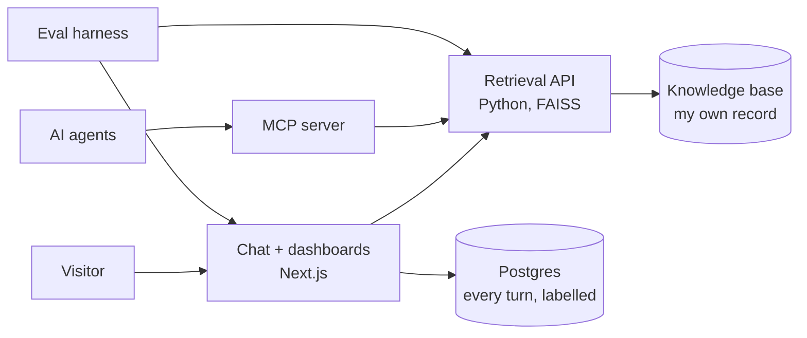

# Hi, I'm Jordanne! 🐱

**Sr. Product Manager · I build DTC products that bridge human and digital moments at scale · Toronto**

[**Ask jordbot about my work →**](https://www.jordannedyck.com) · [LinkedIn](https://www.linkedin.com/in/jordannedyck) · [Email](mailto:jordanne.dyck@gmail.com)

I work in complex, often regulated categories where customers need expert guidance to choose well, whether they're picking a product or signing up for a service: beauty, luxury, pharmacy, grocery, retail and finance. My job is deciding where people guide the customer and where technology does, then building both sides and the handoff between them.

At DECIEM (The Ordinary) I made that call three times. Regimen Builder gave new customers a personalized routine. The AI Personal Shopper was built on top of it. Premium service automation cut resolution time 86% while human agents kept the cases that needed them. Over six years I went from Head of Digital to Director, Digital Product Management, while annual DTC revenue grew from near-zero to $150M+ and the customer base to over 4 million accounts.

Before that I led growth and CRM at Loblaw Digital, across 16 million-plus loyalty customers. My career started in consumer research at Shoppers Drug Mart.

I own the solution in whatever role it needs: setting the strategy, building the product, or the challenger work of making what should exist but doesn't yet. I work with engineering as a counterpart through the build, not a stakeholder at handoff. I still build: the AI on my own site is mine end to end, evals and monitoring included ([how I evaluate it](https://github.com/jordanne-dyck/jordannedyck-ai/blob/master/EVALS.md)).

**Open to:** Senior, Group or Staff Product Manager, Director or Head of Product, ideally at a high-growth Canadian company challenging how its industry works. Also digital consulting.

**Now:** Digital Strategist at Warai Neko, my independent practice, since June 2026.

---

### 📈 Highlighted Ships

Six of the 100+ features I shipped at DECIEM (The Ordinary), as Head of Digital and then Director, Digital Product Management, 2019–2025.

**Where people guide and where technology does**

- **Regimen Builder · 35% higher conversion, 40% higher AOV.** 40% of service tickets were new customers asking where to start. I mystery-shopped every channel and each gave a different answer. I brought CX, brand, the lab, legal and regulatory to one central knowledge base, then built a guided tool that gave each customer a personalized routine. It became the foundation the AI Personal Shopper was built on.
- **AI Personal Shopper · concept to production in 6 months.** Built the first version myself, tested it against Salesforce Agentforce, chose Agentforce for production, piloted in Canada, then handed it to the CX team to scale globally. The prototype Salesforce featured at **NRF 2025** unified discovery, order management and checkout in one conversation. In production I ran recommendations and order operations as two live halves to learn faster; joining them was the next step when my role ended.
- **Premium service automation · 86% faster resolution.** 5,000+ tickets a month, resolution stretching to weeks, 70% of them repetitive. Started narrow, measured quality and sentiment, and scaled only what held. I defined the escalation logic and guardrails that decide when a case leaves automation for a human agent, and brought the service team along by taking the repetitive work off them. Customers couldn't tell the difference.

**The platform, channels and tools underneath**

- **Platform transformation · $150M+ revenue, 150+ countries.** Moved a DIY ecommerce stack, buckling under ~80% YoY growth, to a unified Salesforce ecosystem. Result: 99.95% uptime, 40% faster page loads, 18% conversion improvement.
- **TikTok Shop · zero to a $30M channel, launched 2023.** The first brand fully integrated with TikTok Shop through Salesforce Commerce Cloud, not a catalog upload. Worked with Salesforce and TikTok to take their beta integration to production. It became DECIEM's strongest acquisition channel and the template other Estée Lauder brands followed.
- **Gemini rollout · 75% adoption.** Deployed Gemini company-wide with tiered governance. The highest adoption of any internal tool launch at DECIEM.

---

### 🚀 What I'm Building Now

#### [jordannedyck.com](https://www.jordannedyck.com) · *My portfolio, run as an AI product*

Ask **jordbot**, the AI assistant on the site, anything about my work. It answers from a knowledge base of my own record, cites a source for every claim, and says when the record does not cover something.

I run the site the way I'd run an AI product at work:
- **Evaluated before it ships.** 88 cases, 8 must-pass checks and my own blind scoring. Every comparison carries a 95% range, so a gap inside the noise is reported as noise. [How it's evaluated →](https://github.com/jordanne-dyck/jordannedyck-ai/blob/master/EVALS.md)
- **Monitored after.** Every answer is labelled for grounding, moderation and prompt injection. Volume, latency and spend are public on the [dashboard](https://www.jordannedyck.com/dashboard).
- **The evals made the calls.** They chose the answering model in two blind rounds, kept newer embedding models out after they ranked worse, caught follow-up answers that cited nothing, and found a false claim in my own knowledge base.

<b>How it's built</b>: separate parts that each do one job, so any of them can be swapped, tested or reused

| Part | What it does | Repo |
| --- | --- | --- |
| **Chat front end** | Streamed answers with the cited sources listed under each one. Suggested questions to start, follow-ups answered in context, thumbs up or down on every answer. Input limits and a per-IP rate limit. | [jordannedyck-ai-web](https://github.com/jordanne-dyck/jordannedyck-ai-web) |
| **Monitoring** | Every turn logged to Postgres with emails and phone numbers redacted, then labelled. Health checks every 5 minutes, and one every 6 hours that the chat still gives a grounded answer. | [jordannedyck-ai-web](https://github.com/jordanne-dyck/jordannedyck-ai-web) |
| **Admin view** | Every conversation, anomaly alerts, the questions my record does not cover yet, and real questions exported as new eval cases. | [jordannedyck-ai-web](https://github.com/jordanne-dyck/jordannedyck-ai-web) |
| **Retrieval API** | Hybrid search: embeddings plus BM25 keyword match, merged by reciprocal rank fusion with the embedding top 3 kept, capped per source, and stamped with an index fingerprint so a change in answer quality traces to a specific reindex. | [jordannedyck-ai](https://github.com/jordanne-dyck/jordannedyck-ai) |
| **MCP server** | The same search, exposed as a tool any AI agent can call. | [jordannedyck-ai](https://github.com/jordanne-dyck/jordannedyck-ai) |
| **Eval harness** | Cases, checks, blind scoring and confidence ranges. Uses the same prompt and index as production, and runs on the dev cluster before every release. | [jordannedyck-ai](https://github.com/jordanne-dyck/jordannedyck-ai) |

Runs on OpenShift: containers built in-cluster with Shipwright, deployed from git with Argo CD. CI runs lint, a selftest and a Trivy security scan.

#### [FundLocal](https://fundlocal-ljmo.vercel.app/) · *AI-native community investing, capstone prototype*

A community investment feature designed for Wealthsimple, and my capstone for the Product Faculty AI Product Management Certification. The closest competitor shut down in 2024 because manual compliance review cost $800–$3,200 per proposal. AI brings that to $40–$80, which makes the model viable.

Live prototype: an [investor experience](https://fundlocal-ljmo.vercel.app/) (values intake, AI matching, portfolio) and a [compliance experience](https://fundlocal-ljmo.vercel.app/?view=compliance) (proposal builder, AI evaluation, coaching). AI suggests, a human decides at every critical step.

---

### 🛠️ Toolkit

**AI**

**Commerce and data**

**Build**

---

### ⚡ Beyond the Office
When I'm not building for businesses, I'm creating at home:
- 🏗️ **DIY Home Projects:** Constant home improvements large and small. Re-wiring electrical, custom furniture, interior design, etc.
- 🎸 **Music Production:** Mixing, recording and writing music. I built a [fretboard trainer](https://github.com/jordanne-dyck/fretboard-trainer) for my own daily practice.
- 🛹 **Staying Active:** Skateboarding, snowboarding, yoga, and outdoor exploration.
